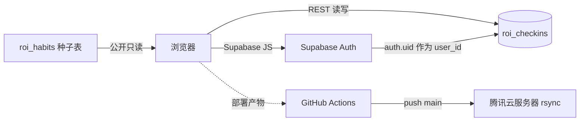

# 人生回报率习惯追踪

基于「人生回报率最高的 32 件事」清单，做的多设备习惯打卡 + 自动分析报告 Web 应用。

## 功能

- **多设备统一账号**：Supabase Auth（邮箱/密码），登录后数据跨设备同步、按用户隔离。
- **今日打卡**：按 7 大类（健康/专注/学习/心智/财务/社交/环境）点选切换，显示 🔥 连续天数与今日完成进度。
- **自动分析报告**：今日完成 / 近 30 天总打卡 / 最长连续 / 最佳类别卡片 + 各类别完成率柱状图 + 30 天趋势折线 + 30 天热力图 + 自动生成的文字报告。

## 技术栈

- 前端：纯静态（HTML + 原生 JS + CSS），CDN 引入 `@supabase/supabase-js@2` 与 `chart.js@4`，零构建步骤。
- 后端：Supabase（PostgreSQL + Auth + Row Level Security）。

## 架构与数据流



- `roi_habits`：32 条习惯参考表（公开只读）。
- `roi_checkins`：打卡记录，RLS 强制 `auth.uid() = user_id`，未登录不可读写。

## 本地运行

```bash
cd habit-tracker-app
python -m http.server 8080
# 浏览器打开 http://localhost:8080
```

`config.js` 已填入 Supabase 项目 URL 与 anon key（公钥，可安全暴露）。

## Supabase 配置（已就绪）

- 项目：`cccbbot's Project`（viellgmgchvzmuypayxz，ap-southeast-1）。
- 表：`roi_habits`（种子已写入）、`roi_checkins`。
- Auth：在 Supabase 控制台 **Auth → Providers → Email** 关闭「Confirm email」，否则注册后需验证邮件才能登录（个人多设备使用更顺滑）。

## 部署到腾讯云（GitHub Actions 自动）

仓库已包含 `.github/workflows/deploy.yml`，push 到 `main` 时通过 `ssh-deploy` 把静态文件 rsync 到腾讯云服务器。

需在 GitHub 仓库 **Settings → Secrets** 配置：

| Secret | 说明 |
|---|---|
| `SERVER_HOST` | 腾讯云服务器公网 IP 或域名 |
| `SERVER_USER` | SSH 登录用户名（如 `ubuntu` / `root`） |
| `SERVER_SSH_KEY` | SSH 私钥（PEM，需已加入服务器 `~/.ssh/authorized_keys`） |
| `DEPLOY_PATH` | 服务器网站根目录（如 `/var/www/habit-tracker`） |

服务器需预装 nginx 并把 `DEPLOY_PATH` 设为站点 root。每次 push 即自动部署。
